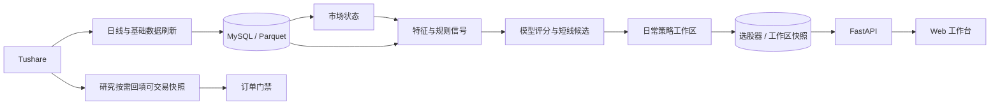
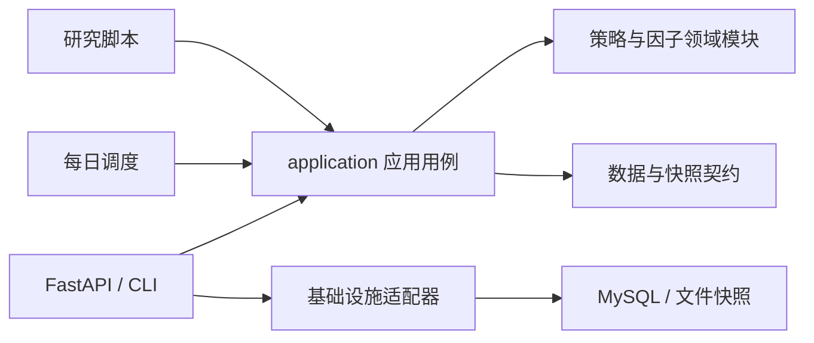
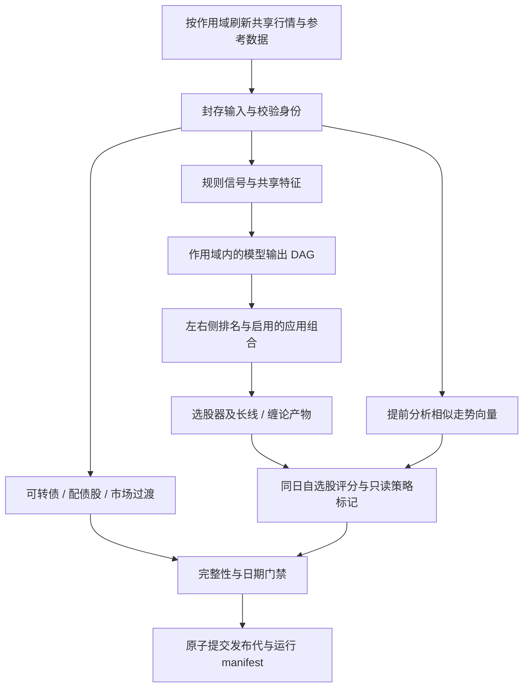

# 系统架构与数据流

## 目标

项目把量化工作拆为四个可独立维护的部分：数据接入、特征与策略计算、每日编排、Web 展示。研究脚本可以快速迭代，但进入每日生产链路的逻辑必须落在 `src/quant/`、配置文件和测试中。

## 组件关系



| 层 | 主要目录 | 责任 |
| --- | --- | --- |
| 数据 | `src/quant/data/` | Tushare 接入、字段标准化、MySQL/Parquet 读写 |
| 特征 | `src/quant/features/` | 市场情绪、市场状态、项目变量和特征合并 |
| 组合与风险 | `src/quant/portfolio/`、`src/quant/risk/` | 目标权重、订单、集中度、尾部风险、压力与容量 |
| 策略 | `src/quant/strategies/` | 可复用的选股、交易和可转债规则 |
| 例行任务 | `src/quant/routine/` | 增量刷新、模型评分、工作区编排和 manifest |
| 应用 | `src/quant/application/`、`src/quant/webapp/`、`web/` | 应用用例、API、刷新状态和页面交互 |
| 基础设施 | `src/quant/infrastructure/` | 工作区快照文件/SQL 仓储等外部存储适配 |
| 研究 | `scripts/research/` | 训练、回测、参数迭代和审计，不直接作为 Web 服务入口 |

## 模块化单体边界

项目保持单进程可部署的模块化单体，不为各工作区拆分独立微服务。新增代码遵循以下依赖方向：



- `src/quant/core/` 保存仓库路径和跨模块基础类型，不依赖应用、例行任务或 Web。
- `src/quant/application/` 保存 API、CLI 和调度共同调用的用例与契约，不导入 `quant.webapp` 或 `quant.routine`。
- `src/quant/infrastructure/` 封装文件系统和 SQL 等技术细节，通过工厂函数接收运行环境依赖。
- `src/quant/routine/` 只负责生产步骤和调度兼容入口，不导入 FastAPI/Web 服务。
- `src/quant/webapp/` 负责 HTTP 参数、错误映射、后台任务入口和静态页面挂载。
- `scripts/research/` 允许调用 `src/quant`，但 `src/quant` 不允许把研究脚本作为普通 Python 模块导入。
- 仍需兼容的研究命令必须集中在明确的任务适配层，逐批把计算实现迁入 `src/quant`，脚本最终只保留参数解析和结果打印。

架构边界由 `tests/test_architecture_boundaries.py` 使用 AST 扫描验证。

### 工作区垂直切片

`application/workspaces` 以“一个工作区一个用例模块”的方式逐步接管原先集中在
`webapp.services` 的计算流程：

- `transition.py` 负责当前市场过渡策略及账户状态；`byd.py` 保留 BYD 历史兼容用例。
- `convertible_bonds.py` 负责可转债网格计划、配债股质量评估和日缓存回退。
- 外部读取、写入、刷新和构建器均通过不可变依赖对象注入，应用层可以脱离 FastAPI 与真实存储测试。
- `webapp.services` 继续保留原公开函数和 monkeypatch 点，只负责构造依赖、兼容旧快照和映射 HTTP 调用。

后续迁移其他工作区时沿用同一模式，不在 `application` 内读取环境变量、实例化数据库连接或导入 Web 层。

### 前端模块与静态交付

- `web/core/api-client.js` 统一超时、取消、错误详情和 `no-store` API 请求。
- `web/core/formatters.js` 统一数值、百分比、金额、区间和 HTML 转义。
- `app.js` 保留页面编排与工作区交互，新增通用能力优先进入 `web/core/`。
- HTML 使用 `no-cache`，JS/CSS 使用 `Cache-Control: public, max-age=3600`；资源 URL 通过版本参数失效。
- FastAPI 对大于 1 KiB 的响应启用 gzip，并预加载两个前端 core 模块。

## 每日流水线

生产入口（与页面“更新全部”共用同一条执行路径）：

```bash
python scripts/run_daily_web_refresh.py
# 或 PYTHONPATH=src python -m quant.routine.cli web-refresh
```



调度和发布边界：

- `daily_dependencies.py` 声明源、特征、模型和产品依赖；输出 DAG 从请求作用域的依赖闭包选择可执行操作。显式空节点集合不执行任何任务。
- 当前左侧 RankNet 使用日线、daily_basic、龙虎榜、资金流、融资融券和所需指数；启用的应用组合依赖两侧评分与共享源。已完成的多输出操作按 owner 去重。
- 源封存后可提前执行相似走势向量分析；策略快照齐备后才补齐同日买入/持有评分和策略标记。缺评分、质量日期不符或自选池成员变化均阻止完成，不能把旧标记贴到新信号上。
- CPU、I/O、内存及数据库连接共享 `ResourceScheduler` 配额，嵌套子任务只拆分已获授权的资源。具体并发取决于依赖、预算和任务声明，不能将各 worker 参数简单相加。
- 长线校验 `tea`、`tea_safe`、`v44` 与 blood-chip；市场过渡校验 `return` 和 `win`。汇总日期不能替代每个必需变体的日期证据。
- 检查点复用要求完整输入、代码、模型与输出身份一致；所有消费者结束后才释放封存输入。失败不会提交半完成的正式发布代。
- `page_refresh_coverage.py` 记录每日页面、用户记录、独立按需页面和可选 ETF 背景的归属；ETF 缺失按既有策略降级，不自动放宽其他产品门禁。

实现审查与性能证据见 [日更效率记录](daily_refresh_performance_20261111.md) 和 [2026-11-14 审查](reviews/2026-11-14-daily-refresh-review.md)。

## Web 工作区

| 页面 Tab | API/服务入口 | 每日更新产物 |
| --- | --- | --- |
| 短线策略 | `/api/selector/stocks` | 模型分、核心/扩展候选和策略快照 |
| 缠论策略 | `/api/chan/strategy-plan` | 缠论模型候选快照 |
| 长线策略 | `/api/long/stock-pool` | 三种长线变体股票池 |
| 可转债策略 | `/api/convertible-bonds/plan` | 转债候选和网格计划 |
| 配债股 | `/api/convertible-bonds/allotments` | 发行流程、关键日期和配售数据 |
| 市场过渡 | `/api/transition/plan`（内部 scope=`byd`） | return / win 两种方案及账户约束 |
| 相似走势 | `/api/similar-patterns/analysis` | 自选池相似案例、同日买入/持有分和策略标记 |
| 股指战法 | `/api/index-futures/refresh` | 独立按需更新预案；历史研究冻结，不属于每日 all |
| 操作计划 / 复盘 | `/api/operation-plans`、`/api/review-records` | 用户维护，日常刷新不覆盖 |

页面上的“更新全部”走后台刷新任务；单页按钮使用对应作用域或专用刷新接口。配债股和相似走势还会检查缓存日期，缓存不是当天时首次打开自动补刷。

## 回测输出边界

本地事件驱动回测保留两层输出：

- `BacktestEngine.run()` 返回 akquant 原始结果，用于兼容底层报告和已有策略代码。
- `BacktestEngine.artifacts` 返回项目自有 `BacktestArtifacts`，供研究脚本、绩效分析、组合构建和后续 Web 展示使用。

稳定契约包含日频净值、收益、持仓、订单、成交、交易、成本和可选基准收益。成本台账不从成交价差推测滑点；底层没有提供的成本分项显式记为 0。绩效层将收益期数与交易笔数分开：期间正收益比例不等同于逐笔交易胜率。

后续接入组合优化或其他回测引擎时，应新增适配器产出同一契约，不在上层代码中判断底层结果类型。

### A 股执行策略边界

- `AShareExecutionConfig` 是项目自有、经过校验的执行口径；佣金、税费、最低佣金、整手、T+1 和成交量参与率不由外部回测库的默认值决定。
- `BacktestEngine` 只在调用 akquant 的边界把项目配置翻译为底层参数，并把原始结果适配成 `BacktestArtifacts`；策略、绩效分析和后续组合层不得依赖 akquant 字段。
- CLI 默认启用 A 股执行配置；保留未传 `execution_config` 的兼容路径，供既有测试和非 A 股研究使用。
- `reference_data_refresh` 每日生成 Tushare point-in-time 可交易分区，覆盖涨跌停价、停牌、ST、上市和退市日期；覆盖率不足会阻断下游。
- `AShareTradabilityPolicy` 是项目订单门禁，由 `OrderManager` 和 `SimulatedBroker` 强制执行。原始 akquant 当前只暴露未稳定的自定义 matcher 协议，因此 `BacktestEngine.check_order()` 提供显式门禁，不能声称底层撮合已自动执行。
- `SimulatedBroker` 执行相同税费、整手、T+1 和容量限制，并持久化账户状态；`reconcile_account` 负责日终现金与持仓差异。

## 系统化研究与组合边界

- `portfolio` 提供等权、评分、逆波动和最小方差目标权重，以及行业、单股、换手、现金和整手订单约束。
- `research.validation` 提供 purge/embargo Walk-Forward，训练和测试时间边界不可重叠；`research.manifest` 固化输入哈希、参数、样本、随机种子、代码和环境。
- `analysis` 提供统一绩效、因子 IC/RankIC/分组收益/换手、行业和 Brinson 归因；`write_backtest_report` 发布完整报告包。
- `risk` 提供集中度、行业暴露、历史 VaR/CVaR、压力损失和按 ADV 估算的变现天数；研究指标与送单前硬限制分层实现。

## 存储与缓存

### 行情存储

`MarketDataStore` 由环境变量控制：

- 配置 `MARKET_DATA_SQL_URL` 时读写 MySQL。
- 日线只写统一表 `market_daily`，以 `(ts_code, trade_date)` 为唯一键批量 upsert，不再创建逐股票分表。
- `MARKET_DATA_MIRROR_PARQUET=1` 时同步更新年月分区 `data/raw/daily_partitioned/year_month=YYYYMM/data.parquet`，不再重写逐股票历史文件。
- 未配置 SQL URL 时，本地读取可回落到 Parquet。

### 应用快照

- 短线选股器快照按日期、策略组合和扩展标记区分。
- Web 工作区快照按工作区、日期和参数哈希区分，SQL 表为 `web_workspace_snapshots`。
- 工作区快照的日期回退、原子文件发布和 SQL 回退统一由 `WorkspaceSnapshotRepository` 处理；Web 层只组装路径和存储工厂。
- 配债股最新日缓存位于 `data/routine/convertible_bond_allotments_latest.json`。
- 相似走势自选池、分析和向量缓存位于 `data/research/similar_patterns/`。
- 后台刷新状态位于 `data/routine/latest_refresh_status.json`，服务重启后仍可读取最后状态。

### 缓存生命周期

- `data/raw/` 和 MySQL 行情表是正式数据，不按请求缓存规则删除。
- `data/cache/source_merge/tushare/` 是可重新拉取的请求级缓存：单股日线和已有正式 Parquet 副本的 `daily_basic` 只保留最近 7 天。
- `data/research/long_dividend_quality/` 是手工研究/回测中间缓存，只保留最近 2 组；生产长线股票池直接复用内存中的共享输入。
- 相似走势全市场历史参考向量最多每 7 天重建一次，只保留最新配置目录；自选池股票每天使用最新日线现场计算目标向量。
- smoke 向量缓存不属于生产数据，清理时全部删除。
- 每次完整刷新开始前执行统一清理；也可运行 `PYTHONPATH=src python -m quant.routine.cli cache-cleanup` 手工触发。

所有本地产物目录均由 `.gitignore` 排除。

## 关键设计约束

- 业务层优先复用 `MarketDataStore`、`TushareDataFetcher` 和既有标准化函数，不重复创建 Token、缓存、存储或代码映射体系。
- 生产行情口径以 Tushare 为准；适配层只转换字段，不混用数据源。Tushare 没有等价字段时，其他来源必须通过独立适配器接入，并显式记录来源、口径、时点和降级原因。
- 外部回测库和外部数据源都是可替换适配器；项目自有契约、执行规则和领域逻辑不得以外部库默认行为作为事实来源。
- 每日任务应可重复执行；同日期产物采用覆盖、替换或稳定快照键，不做无界追加。
- Web 请求不应承担完整历史训练；训练和大规模回测留在研究脚本中。
- 策略配置、实现、测试和策略档案必须同步变更。
